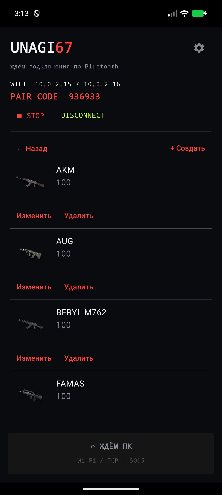
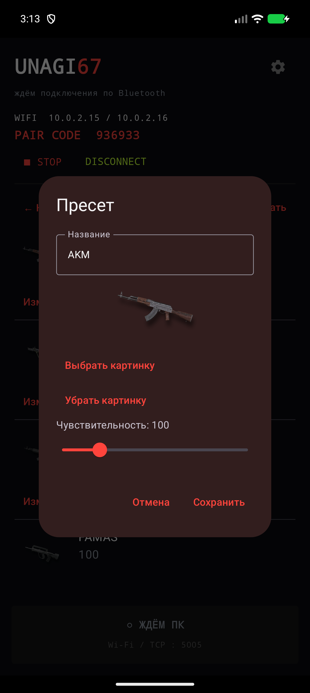

# UNAGI 67 · v0.5

Приложение Android и мост Windows: управление по Wi-Fi + Bluetooth HID, без USB. В комплекте APK, EXE с необходимыми библиотеками, инструкции и скриншоты.

[English instructions](README.md)

## Скачать

- [Android APK · v0.5](downloads/Unagi67-v0.5.apk)
- [Windows x64 · v0.5 ZIP](downloads/Unagi67-Windows-v0.5.zip)
- [SHA-256](SHA256SUMS.txt)

## Установка и подключение

1. Установи **Unagi67-v0.5.apk** поверх предыдущего приложения на Android 9 или новее. Это debug-сборка; подпись совпадает с предоставленным APK v0.4. Обновление поверх сохраняет данные.
2. Скачай и распакуй Windows ZIP целиком. Запусти **Unagi67_WiFi_Bridge/Unagi67_WiFi_Bridge.exe** на Windows x64. Папка `_internal` должна оставаться рядом. Python устанавливать не нужно.
3. Подключи телефон и ПК к одной локальной сети. ПК может использовать Ethernet. Открой приложение и предоставь разрешения Bluetooth.
4. Сохрани существующую Bluetooth-пару с ПК. Если пары ещё нет, выполни сопряжение в настройках Bluetooth Windows при открытом приложении.
5. Введи Wi-Fi IP и шестизначный код с телефона в Windows-приложение и нажми **ПОДКЛЮЧИТЬ / WIFI**.
6. Нажми **ОТКАЛИБРОВАТЬ МЫШЬ**, затем ЛКМ своей физической мышью. Выбери и настрой пресет на телефоне перед включением режима.

## Пресеты

Открой **STROKE → пресеты** или **TAP → пресеты**. Нажатие на карточку выбирает пресет. Кнопка **Создать** добавляет новый; **Изменить** позволяет задать название, изображение и значение; **Удалить** удаляет пресет после подтверждения.

Встроены 19 пресетов с названиями исходных картинок: ACE32, AKM, AUG, BERYL M762, FAMAS, G36C, GROZA, JS9, K2, M416, MICRO UZI, MP5K, MP9, P90, QBZ, SCAR-L, THOMPSON, UMP и VECTOR. Начальные значения — чувствительность 100 и 5 кликов/с. Это отправная точка, а не готовая настройка под оружие: пользователь выбирает значения сам.

Названия и картинки общие для двух режимов. Каждый пресет отдельно хранит **чувствительность STROKE (1–500)** и **частоту TAP (1–20 кликов/с)**. Для режимов можно выбрать разные пресеты. Чувствительность регулирует движение ассистента, а не настройки чувствительности внутри игры.

На экране режима значения сохраняются автоматически. В редакторе нужно нажать **Сохранить**. Названия, картинки, значения и выбор пресета сохраняются после закрытия приложения и перезагрузки телефона. Выбранная картинка копируется во внутреннее хранилище приложения — исходный файл из галереи больше не нужен.

Встроенные пресеты можно удалять. Они не появляются заново после перезапуска, даже если удалить все. Ранее сохранённые значения v0.4 переносятся в отдельные пресеты **Saved N**.

Удаление приложения или очистка его данных удаляет локальные пресеты. Обновляй приложение поверх установленного.

## Экстренная остановка

В Windows нажми **КЛАВИША СТОП: F8**, затем нужную клавишу клавиатуры. Назначение сохраняется в `bridge_config.json` рядом с EXE. Папка должна быть доступна для записи; при обновлении Windows-сборки сохрани этот файл.

Поддерживается одна клавиша: например F8, F9, буква, цифра или Escape. Отдельные Ctrl, Alt, Shift и Win исключены; сочетания и кнопки мыши не поддерживаются. Нажатие продолжает поступать и другим приложениям. STOP работает после запуска обработчика ввода при подключении, в том числе когда окно моста находится в фоне. Средняя кнопка мыши больше не вызывает STOP.

STOP выключает режимы и скрывает лупу. На телефоне также остаётся экранная кнопка STOP. После обрыва связи режимы остаются выключенными до ручного включения.

## Лупа и фоновая работа

По умолчанию лупа находится в центре основного монитора. Чтобы выбрать другой, нажми **ЦЕНТР ИГРОВОГО МОНИТОРА** и кликни на нужном мониторе. Используется центр монитора; предполагается полноэкранный или безрамочный режим игры.

Соединение Android работает в foreground service. Обычное сворачивание должно сохранять работу; **DISCONNECT** и принудительная остановка Android завершают службу. После перезагрузки телефона открой приложение для запуска соединения — пресеты сохранятся. Фоновые ограничения прошивки и Bluetooth HID нужно проверить на физическом телефоне.

Если Wi-Fi не подключается, проверь адрес, код, общую сеть и отсутствие изоляции клиентов на роутере. Телефон слушает TCP 5005. Используй доверенную локальную сеть: соединение не шифруется. USB, ADB и отладка по USB для работы не нужны.

## Скриншоты

Настоящие экраны v0.5 в Android-эмуляторе. Один встроенный пресет удалён при проверке сохранения; новая установка содержит все 19.

 

## Проверки

22 октября 2026: сборка APK и Android lint прошли (0 ошибок, 28 предупреждений). На Android проверены создание, переименование, выбор, отдельные значения режимов, удаление всех встроенных пресетов, перенос старых данных и импорт картинки. Сохранение проверено после остановки процесса и перезагрузки эмулятора. Прошли 8 тестов Python: назначение клавиши и повторные нажатия, обработка Raw Input, отсутствие STOP на средней кнопке, переподключение транспорта и центрирование нативной лупы. Готовый EXE успешно запущен.

На физическом телефоне Bluetooth HID, работу в конкретной игре и реальное нажатие STOP во время игры в этой проверке не тестировали.
